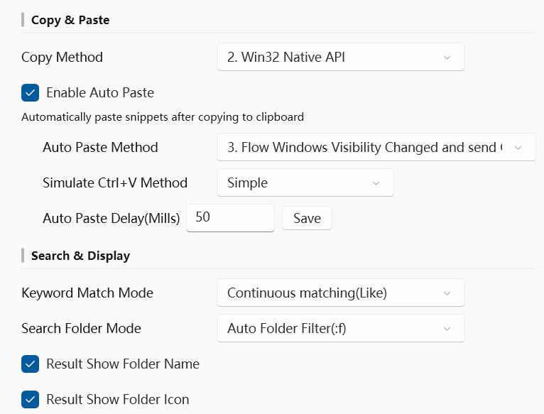
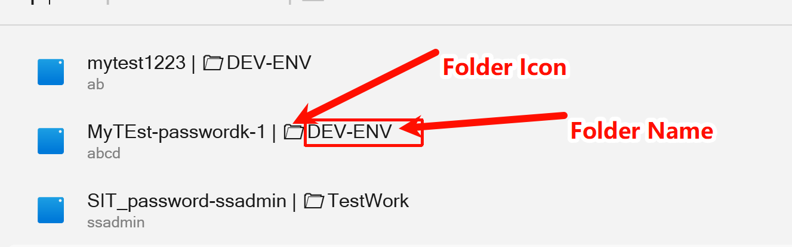
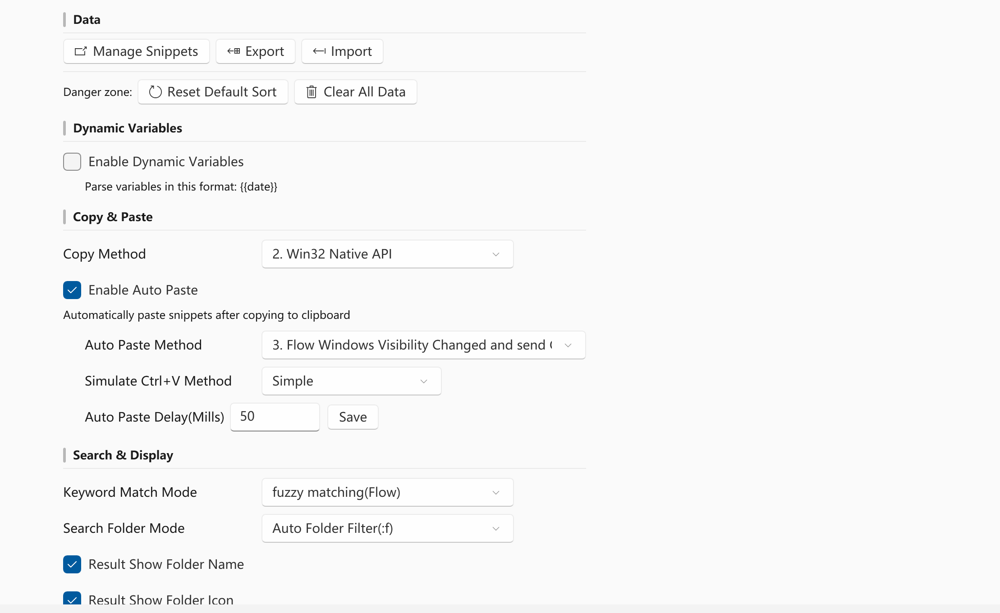
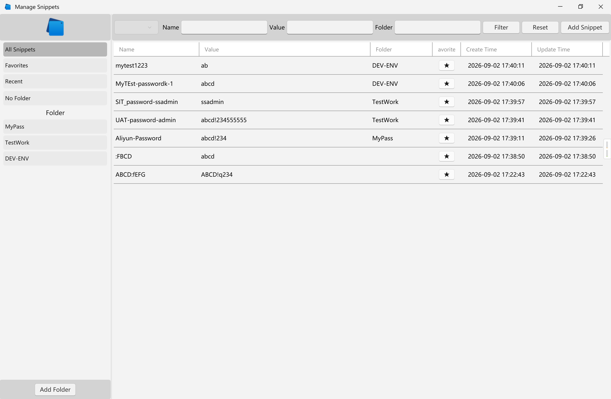
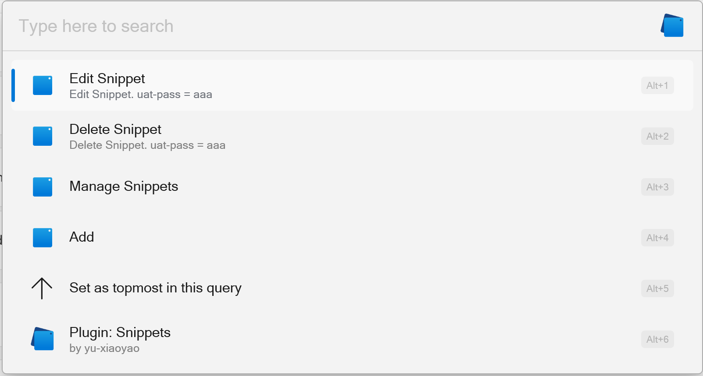
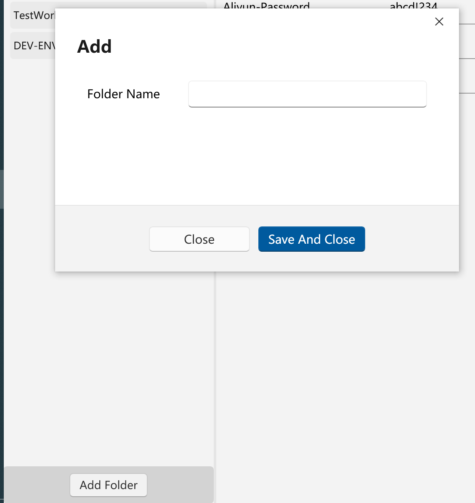

Flow.Launcher.Plugin.Snippets
==================

A snippets plugin for the [Flow launcher](https://github.com/Flow-Launcher/Flow.Launcher).

## Usage

    sp <arguments>

## V3 Features

## Features

- Search and manage snippets by name or folder name
- Support add to Snippet 
- Auto-paste functionality (optional)
- **Dynamic variables** for date and time (e.g., `{{date}}`, `{{time}}`, `{{timestamp}}`)

### Compatibility
> Auto Upgrade and move data. 2.3.x -> 3.0.0

- [v2.3.x branch]([https://github.com/yu-xiaoyao/Flow.Launcher.Plugin.Snippets/releases/tag/v2.0.4](https://github.com/yu-xiaoyao/Flow.Launcher.Plugin.Snippets/tree/v2.3.x))

### ⚠️ Upgrade to v3.x.x
#### 1. Upgrade to `3.x.x` Features. sqlite new table name: `snippet_3`.
> only support SQLite storage. Remove JSON Storage
#### 3. ⚠️ Incompatible for version: `v1.x.x`
⚠️⚠️upgrade version: `v1.x.x -> 3.x.x`:

1. `️Simple Storage Version` data can not upgrade to 3.x.x version
   and
2. data will loss.

#### Compatibility for version. `2.x.x`
##### 1. v2.x.x Storage type: JSON
1. JSON Storge Snippet auto save to Sqlite table: `snippet_3`.
2. Setting: Storage type auto set to Sqlite
3. JSON storage file name rename to `JsonSetting.json.v2` , Old File Path: `%APPDATA%\FlowLauncher\Settings\Plugins\Flow.Launcher.Plugin.Snippets\JsonSetting.json.v2`

##### 2. v2.x.x Storage type: Sqlite
1. Sqlite data auto move to new table name: `snippet_3`
1. Sqlite db file: `%APPDATA%\FlowLauncher\Settings\Plugins\Flow.Launcher.Plugin.Snippets\snippets.db`
2. old data table name: `snippet`, new data table name: `snippet_3`

## Recommended Settings

## Settings Explain

### Copy & Paste

#### Copy Method

- `0. Flow Launcher API` : use Flow Launcher Plugin `PluginInitContext.API.CopyToClipboard`
- `1. Dotnet API` : use .net `System.Windows.Clipboard.SetText()`
- `2. Win32 Native API` : use `kernel32.dll` and `user32.dll` method Copy Text to Clipboard

#### Enable Auto Paste

> Auto Paste Snippet to Last Windows Input focus. `can not paste to run as Administrator Program`

- [x] Enable Auto Paste

**Recommended Settings**

- Auto Paste Method: `3. Flow Windows Visibility Changed and send Ctrl + V`
- Simulate Ctrl+V Method: `Simple`
- Auto Paste Delay(Mills): `50`

### Search & Display

**Demo Data**

1. dev-pass
2. test-password
3. uat-pass

#### Keyword Match Mode

**fuzzy matching(Flow)**

1. input: `eass`. result: `dev-pass`, `test-password`
2. input: `t-ass`. result: `test-password`, `uat-pass`

**Continuous matching(Like)**

1. only input Continuous char can match. `ev-pass` or `dev-pass` or `v-pas` -> `dev-pass`

#### Search Folder Mode

> Filter Folder Name. Params: `:f`

- `Disable Folder Filter(:f)` Disable Search Filter
  - `sp SnippetName`
- `Auto Folder Filter(:f)`  Auto Detect `:f` Params
  - `sp :f FodlerName SnippetName`
  - `sp SnippetNmae :f FodlerName`
- `First Folder Filter(:f)`
  - `sp :f FodlerName SnippetName`
- `Last Folder Filter(:f)`
  - `sp SnippetName :f FodlerName`

#### Result Show

- [x] Result Show Folder Name
- [x] Result Show Folder Icon

### Dynamic Variables

- [x] `Enable Dynamic Variables`

> Snippets can include dynamic variables that are automatically expanded when the snippet is used. This is useful for inserting current dates, times, and timestamps.

#### Supported Variables

**Date Variables:**

- `{{date}}` - Current date in ISO format (e.g., `2026-02-10`)
- `{{date:format}}` - Current date with custom format (e.g., `{{date:MM/dd/yyyy}}` → `02/10/2026`)
- `{{year}}` - Current year (e.g., `2026`)
- `{{month}}` - Current month with leading zero (e.g., `02`)
- `{{day}}` - Current day with leading zero (e.g., `10`)

**Time Variables:**

- `{{time}}` - Current time in 24-hour format (e.g., `14:30:45`)
- `{{time:format}}` - Current time with custom format (e.g., `{{time:hh:mm tt}}` → `02:30 PM`)
- `{{hour}}` - Current hour with leading zero (e.g., `14`)
- `{{minute}}` - Current minute with leading zero (e.g., `30`)
- `{{second}}` - Current second with leading zero (e.g., `45`)

**Combined Variables:**

- `{{datetime}}` - Current date and time (e.g., `2026-02-10 14:30:45`)

- `{{datetime:format}}` - Date and time with custom format (e.g., `{{datetime:yyyy-MM-dd HH:mm}}`)

- `{{timestamp}}` - Unix timestamp in seconds (e.g., `1770700117`)

- Storage Type: Choose between JSON (lightweight) or SQLite (for large datasets)

- Auto-Paste: Enable or disable automatic pasting of snippets after copying to clipboard

- Paste Delay: Configure the delay (in milliseconds) before pasting

> Note: When changing storage types, data migration is not automatic. Follow the migration steps above.

#### Usage Examples

1. **Daily log file**: `log_{{date}}.txt` → `log_2026-02-10.txt`
2. **Timestamped note**: `Meeting notes - {{datetime}}` → `Meeting notes - 2026-02-10 14:30:45`
3. **Custom date format**: `Report {{date:MMMM dd, yyyy}}` → `Report February 10, 2026`
4. **Backup filename**: `backup_{{timestamp}}.zip` → `backup_1770700117.zip`

For custom formats, you can use any valid [.NET date and time format string](https://docs.microsoft.com/en-us/dotnet/standard/base-types/custom-date-and-time-format-strings).

#### 

### Snapshots

#### Settings

#### Manage

#### Item Context Menu

#### Add Folder

#### Add Snippets

#### Resources

* Icons are from https://icons8.com/icons.
